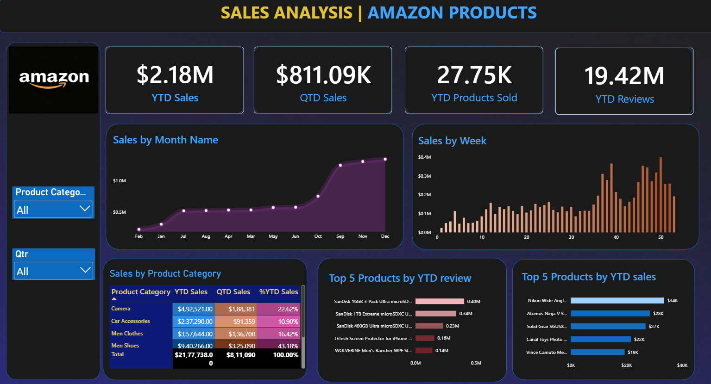

# Sales Analysis | Amazon Products

A Power BI dashboard that analyzes year-to-date sales, product performance and customer reviews for Amazon products across multiple categories.



## Objective
Track sales performance over time, identify the best-selling categories and products, and understand which products receive the most customer reviews.

## Key Metrics
| Metric | Value |
|---|---|
| YTD Sales | $2.18M |
| QTD Sales | $811.09K |
| YTD Products Sold | 27.75K |
| YTD Reviews | 19.42M |

## Dashboard Features
- KPI cards: YTD sales, QTD sales, YTD products sold, YTD reviews
- Sales by Month (area chart) and Sales by Week (column chart)
- Sales by Product Category table with YTD Sales, QTD Sales and % of YTD Sales
- Top 5 Products by YTD Reviews and Top 5 Products by YTD Sales
- Slicers: Product Category and Quarter

## Key Insights
- **Men Shoes** is the largest category, contributing about **43%** of YTD sales, followed by Camera (about 23%), Men Clothes (about 16%) and Car Accessories (about 11%).
- Sales stay steady through most of the year and **rise sharply from September to December**.
- Weekly sales peak in the **last quarter of the year (weeks 40-50)**.
- Camera products dominate the Top 5 by YTD sales, led by the Nikon wide-angle lens at about $34K.
- SanDisk memory cards take the top three spots for YTD reviews.

## Tools Used
- Power BI (dashboard and visuals)
- DAX (YTD, QTD and % measures)
- Excel / CSV (data source)

## Repository Structure
```
amazon-sales-analysis-dashboard/
├── README.md
├── .gitignore
├── amazon_dashboard.png
├── Amazon_Sales_Dashboard.pbix
└── amazon_sales_data.xlsx
```

## How to Use
1. Clone this repository.
2. Open `Amazon_Sales_Dashboard.pbix` in Power BI Desktop.
3. If prompted, point the data source to `amazon_sales_data.xlsx`.
4. Use the Product Category and Quarter slicers to filter the dashboard.

## Note
This is a personal portfolio project. It is not affiliated with or endorsed by Amazon.

## Author
**Alen**: Data Science & Analytics graduate, Thrissur, Kerala
